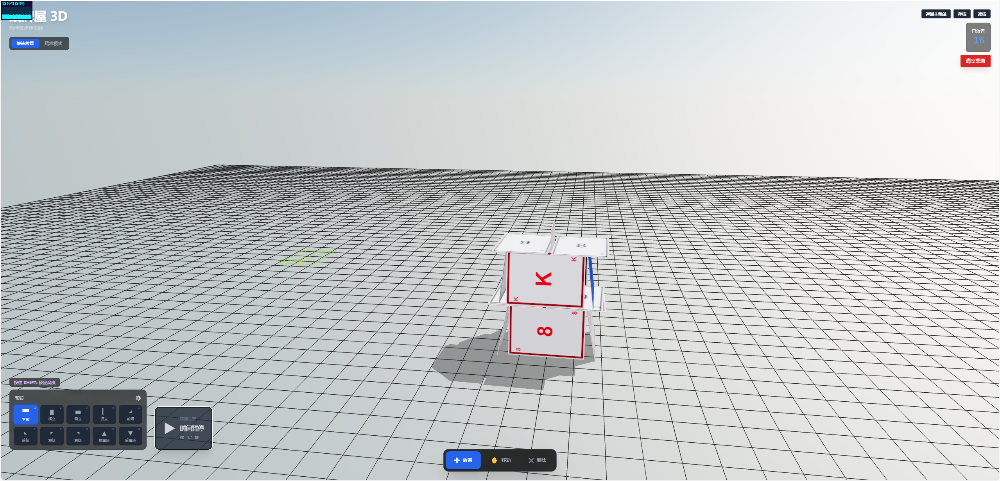
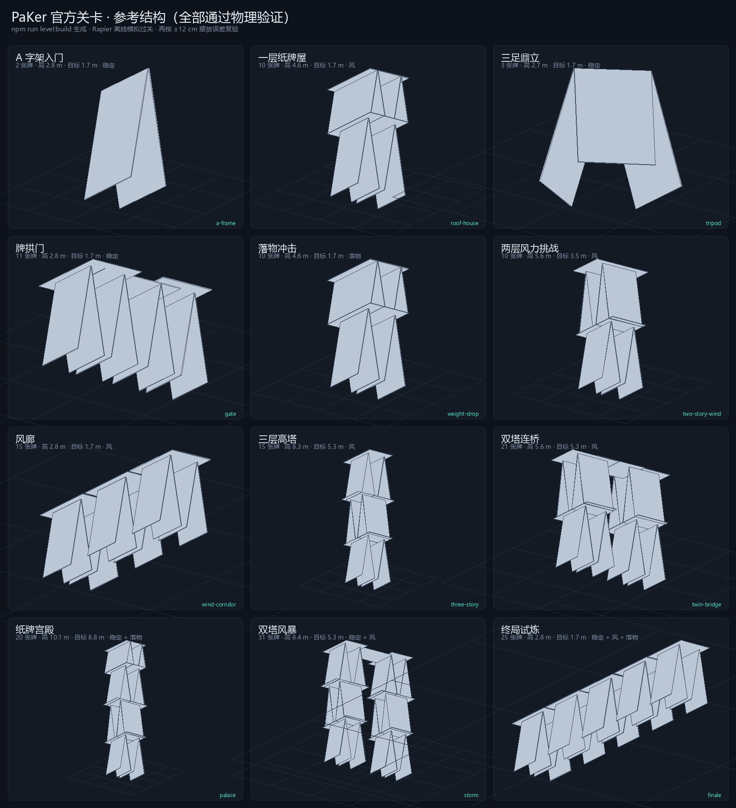
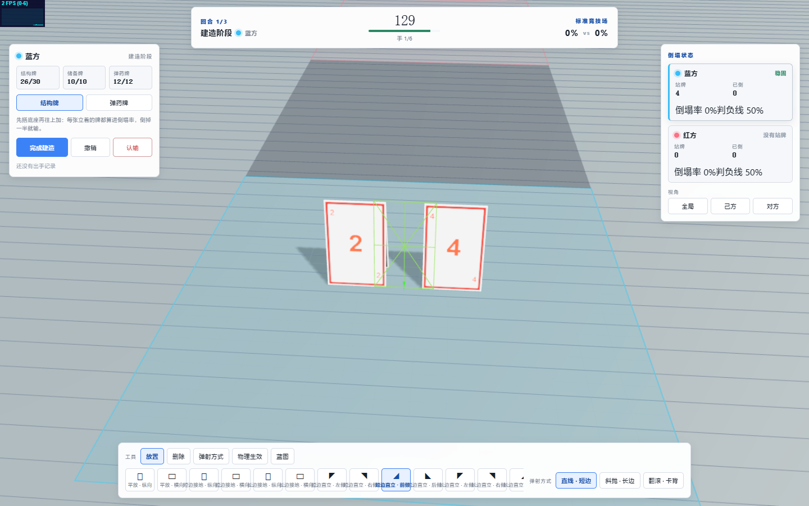

# 🃏 PaKer (House of Cards 3D)

[](https://opensource.org/licenses/MIT)
[](https://react.dev/)
[](https://threejs.org/)
[](https://vitejs.dev/)

**PaKer** 是一款基于物理引擎的 3D 纸牌建筑沙盒游戏。在这里，你可以利用物理规则，用一张张扑克牌构建出令人惊叹的复杂结构，或者在瞬间见证它们的坍塌。

[简体中文](#-简体中文) | [English](#-english)

---

## 🇨🇳 简体中文

### 📖 项目简介

**PaKer**（纸牌屋 3D）是一个结合了物理模拟与 3D 建模技术的创意实验场。它不仅仅是一个游戏，更是一个探索平衡、结构与重力的数字工具。无论是为了挑战搭建世界最高的纸牌塔，还是为了创造独特的几何艺术，PaKer 都为你提供了极致的操控感。



### ✨ 核心特性

*   **🧪 动力学物理模拟**: 核心由 Rapier 驱动。每张纸牌都拥有真实的质量、摩擦系数、碰撞体和连续碰撞检测，模拟真实世界中的物理反馈并避免薄纸牌穿模。
*   **⏳ 时间操控艺术**: 
    *   **时间暂停 (`F`)**: 冻结所有物体的物理状态，在“真空”中进行构思与搭建。
    *   **恢复物理**: 一键解除冻结，看重力如何决定你结构的命运。
*   **🛠️ 双重建造系统**:
    *   **快速模式 (Quick Mode)**: 智能表面吸附，跟随鼠标指引，适合大规模快速成型。
    *   **精准模式 (Precision Mode)**: 引入专业级 Gizmo 坐标轴控制（平移与旋转），实现毫米级的建筑对齐。
*   **🔄 深度旋转控制**: 使用左手六键调整偏航、前后倾和左右倾，并通过姿态轮盘快速选择放置预设。
*   **� 持久化管理**: 内置存档/读档功能，支持自定义旋转预设，所有的创作和偏好都会同步到 `localStorage`。

### 🎮 操作指南

#### 全局快捷键
| 按键 | 功能描述 |
| :--- | :--- |
| **1 / 2 / 3** | 切换 **放置 / 移动 / 删除** 工具 |
| **F** | **冻结 / 恢复物理** |
| **Tab** | 切换 **快速放置 / 精准编辑** |
| **Ctrl + Z / Ctrl + Y** | **撤销 / 重做** |
| **Esc** | 取消当前操作 |

#### 建造控制
*   **左键**: 放置、选择和确认
*   **右键拖动 / 中键拖动 / 滚轮**: 旋转镜头 / 平移镜头 / 缩放
*   **Q / E**: 水平左转 / 右转
*   **W / S**: 后倾 / 前倾
*   **A / D**: 左倾 / 右倾
*   **R**: 恢复当前预设旋转
*   **按住 Space**: 锁定当前高度

## 蓝图工作台

在自由搭建或关卡界面点击顶部的 **蓝图**，可以把场景中每张牌此刻的真实物理位置和姿态捕获为结构蓝图。蓝图与普通游戏存档相互独立，支持：

*   录制后续放置的卡牌并自动生成步骤
*   编辑步骤时间线、卡牌分组、说明、推荐预设与镜头提示
*   设置位置、旋转和接近提示容差
*   将蓝图投影到场景，选择原点和方向并逐步搭建
*   实时判定位置、姿态和接地边，显示步骤进度并支持失败恢复
*   蓝图搭建不覆盖物理状态，所有卡牌统一服从场景“物理”开关
*   四个循序解锁的官方教学：A 字架、双 A 字支撑、横梁和一层纸牌屋
*   完整结构、当前步骤、关键牌三档投影辅助，课程完成状态会自动保存
*   保存草稿、发布、从头测试、导入和导出
*   **Ctrl / Alt + 旋转键**: 1° 精调 / 45° 快速调整
*   **Enter**: 精准模式确认放置

## 关卡编辑器

主菜单进入 **关卡编辑器**，无需修改代码即可：

*   从个人或官方蓝图创建关卡
*   设置牌数、高度、稳定性、风力或落物测试参数
*   编排稳定性、风力和落物冲击等连续测试阶段
*   将完整蓝图副本内嵌到关卡，源蓝图删除或修改后关卡仍可运行
*   编辑、复制、试玩、认证、发布、导入和导出关卡
*   使用同一种格式制作官方关卡和玩家自定义关卡

关卡文件包含蓝图完整性校验；被意外修改或损坏的文件不会导入。

### 官方战役：三章 12 关



12 关全部由 `npm run level:build` 生成：每个参考结构都先在无头 Rapier 里跑通自己的
测试（并留出安全余量、按 ±12 cm 摆放误差复验），站不住的关卡不会被写进游戏。
关卡数据在 `services/officialLevelData.generated.ts`，可导入的关卡文件在
`public/levels/`，设计说明见 [docs/level-factory.md](docs/level-factory.md)。

```bash
npm run level:build         # 生成 + 物理验证 + 导出关卡文件
npm run test:level-factory  # 用真实运行时服务复验生成结果
```

| 章节 | 关卡 | 新机制 |
| :--- | :--- | :--- |
| 一 · 搭建基础 | A 字架入门 / 一层纸牌屋 / 三足鼎立 / 牌拱门 | 摩擦、封顶、三向支撑、跨与承重 |
| 二 · 结构考验 | 落物冲击 / 两层风力挑战 / 风廊 / 三层高塔 | 承重路径、交错抗风、分散承重、竖向传递 |
| 三 · 极限工艺 | 双塔连桥 / 纸牌宫殿 / 双塔风暴 / 终局试炼 | 连成整体、收口屋顶、抗风塔、三重考验 |

#### 放置预设

*   **按住 C**: 打开鼠标姿态轮盘，松开应用所选预设
*   **Shift + Q / Shift + E**: 切换上一个 / 下一个预设
*   设置中可以切换回旧版键位，或重新绑定任意操作

## 纸牌攻城 · 1v1 对战



一人操作蓝红两方，轮流建造堡垒、亲手弹射纸牌，把对手立着的牌打倒一半。
物理即规则：没有血条和隐藏伤害，牌面翻倒或被撞飞就是真塌了。

*   **竞技场**：双方各一块 15×15 格的场地（一格 = 地面小网格 0.9），中间 15 格非战斗区
*   **建造**：每方 150 秒，只能在自己的场地放牌；结束建造至少要立起 4 张站牌
*   **稳定检查**：建造结束强制解除冻结，结构自己站住才算数
*   **回合**：检查 3s → 工程 15s（放 1 张储备牌或装填 1 张弹药）→ 发射 20s → 结算 ≤6s
*   **倒塌判定**：立着的牌翻面 / 掉 1 格 / 被撞飞 3 格算倒下，倒塌率到 50% 判负
*   **蓝图**：建造阶段可打开蓝图工作台，一键放置整张结构，或按半透明投影逐步搭建
*   **资源**：30 结构牌 + 10 储备牌 + 12 弹药牌（开始前可调）

```bash
npm run test:battle        # 引擎自测（无浏览器）
```

规则、判定阈值与代码结构见 [docs/battle-system.md](docs/battle-system.md)，
原始设计稿在 [docs/pvp-battle-mode-design.md](docs/pvp-battle-mode-design.md)。

---

## 🇺🇸 English

### 📖 Overview

**PaKer** (House of Cards 3D) is a physics-based construction sandbox that merges engineering principles with creative freedom. Build intricate card structures using realistic physics or defy the laws of nature with time-manipulation tools.

### ⚔️ Card Siege (1v1)

Run both sides yourself: build a fortress, then hand-fire cards until half of the other side's standing cards are down. There is no health bar — a card that tips flat or gets knocked three cells away is simply down.

*   15 × 15 cell build square per side (a cell is the 0.9 ground grid), with a 15 cell neutral band between them
*   150 s build per side, then a settle check that forces physics back on; you need at least four standing cards to finish
*   Turns: inspect 3 s → engineer 15 s → fire 20 s → resolve ≤6 s
*   Collapse: a standing card counts as fallen once it lies flat, drops a cell or flies three cells; 50% loses
*   Blueprints: drop a saved or official structure in one click, or build along a translucent projection
*   30 structure + 10 reserve + 12 ammo cards per side

```bash
npm run test:battle        # engine self-test, no browser required
```

### ✨ Key Features

*   **Realistic Physics**: Cards have volume, mass, friction, and CCD, powered by Rapier.
*   **Time Control**: Freeze space to build gravity-defying architectures, then unfreeze to let physics take its course.
*   **Hybrid Workflow**: Switch between effortless **Quick Build** and pixel-perfect **Precision Mode** with industry-standard Gizmos.
*   **Configurable**: Customize your own rotation presets and save your progress locally.

### 🛠 Tech Stack

- **UI Framework**: React 19 + TypeScript
- **3D Graphics**: React Three Fiber (Three.js)
- **Physics**: React Three Cannon
- **State & Persistence**: React Hooks + LocalStorage
- **Bundler**: Vite

### 🚀 Getting Started

1.  **Clone** this repository.
2.  **Install dependencies**:
    ```bash
    npm install
    ```
3.  **Start the desktop development build**:
    ```bash
    npm run dev
    ```

### 🖥️ Desktop Commands

| Command | Purpose |
| :--- | :--- |
| `npm run dev` | Start Vite and the Electron desktop window with hot reload |
| `npm run dev:web` | Start the browser development server only |
| `npm run build` | Build the production renderer into `dist/` |
| `npm run desktop` | Build and launch the production desktop app |
| `npm run pack:win` | Generate an unpacked Windows app in `release/win-unpacked/` |
| `npm run dist:win` | Generate the Windows installer in `release/` |

The production desktop shell uses context isolation, renderer sandboxing, disabled
Node integration, denied browser permissions, and restricted external navigation.
Press `F11` or `Alt + Enter` to toggle fullscreen, and `Esc` to leave fullscreen.

---

## 🎨 UI & Design
The interface is designed to be minimal yet powerful, featuring a sleek dark theme, responsive layouts, and a native language toggle (CN/EN) for global accessibility.

## 📄 License
Distributed under the MIT License. See [LICENSE](LICENSE) for more information.
