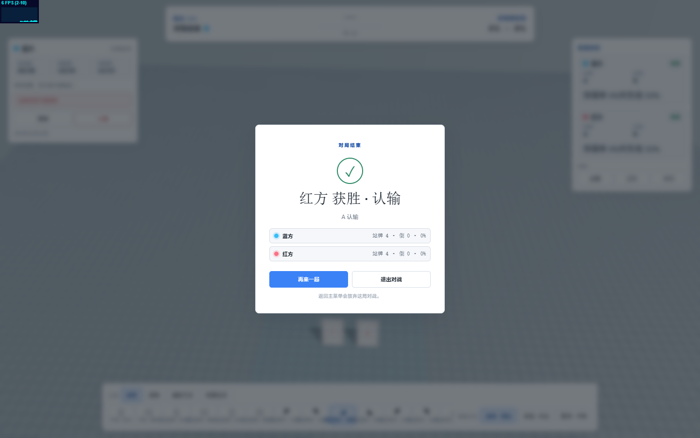

# 纸牌攻城 · 对战系统（Card Siege）

> 一句话：一人操作蓝红两方，**建造 → 稳定检查 → 回合（检查 / 工程 / 发射 / 结算）→ 站牌倒掉一半即负**。
> 物理即规则：没有血量、没有隐藏加成，胜负只由场上真实纸牌的朝向和位移决定。


## 一、为什么是这套规则

设计文档（[pvp-battle-mode-design.md](pvp-battle-mode-design.md)）把对战拆成三件事：
工程设计、资源分配、弹射技术。本项目已有的弹射系统（接触点 + 蓄力 + 线速度/角速度）正好是第三件事，
所以这一版**没有新增任何"伤害数值"**，只补了三样东西：

1. **竞技场与区域**：双方各一块 15×15 格的场地，中间是 15 格宽的非战斗区；
2. **倒塌判定**：不设核心牌，改由"站牌倒下比例"决定胜负（v1 规则）；
3. **回合控制器**：建造 → 稳定 → 每回合四个阶段，8 回合上限 + 平局判定。

## 二、场地

单位是**地面网格的一格**（`gridCellSize = 卡牌宽度 / 2 = 0.9`），所以所有尺寸都能和地面上看到的小格子对上：

| 项目 | 格 | 世界单位 |
|---|---|---|
| 单侧建造区 | 15 × 15（正方形） | 13.5 × 13.5 |
| 中间非战斗区 | 15 深 | 13.5 |
| 场地总深 | 45 | 40.5 |
| 场地宽 | 15 | 13.5 |

- 蓝方在 +Z 半场，红方在 −Z 半场，中间那条深色带谁都不能放牌；
- 双方场地边缘到边缘相距 15 格，最远弹道（24.5 速度、45°）射程约 61，足够互相打到；
- **视角**：每个建造阶段和每个回合开始时，镜头默认站到**自己阵地的后方、看向对手**
  （自己的场地占屏幕下三分之一，中间是非战斗带，对手的阵地在上面三分之一，两边都能看全）；
  右侧的「全局 / 己方 / 对方」可以随时切：全局俯视全场、己方回到对战视角、对方贴近看对手阵地；
  滚轮缩放、右键拖动自由环绕；
- 场地标记（区域底色、每格细线、非战斗区虚线）由 `components/BattleArena.tsx` 画在地面上，
  规则本身在 `battle/arena.ts`。

## 三、回合流程

| 阶段 | 时长 | 能做什么 |
|---|---|---|
| 建造（蓝） | 150 s | 只能在自己的 15×15 场地里放结构牌 / 弹药牌，可以用蓝图 |
| 建造（红） | 150 s | 同上，换成红方 |
| 稳定检查 | 4 s | 双方都不能操作，**物理强制解除冻结**，结构自己站住才算数 |
| 检查 | 3 s | 无操作，看战场 |
| 工程 | 15 s | 放 1 张储备牌，或装填 1 张弹药；放完立刻进入发射 |
| 发射 | 20 s | 切到"弹射方式"工具，按住**自己的弹药牌**蓄力松手；也可以放弃 |
| 结算 | ≤ 6 s | 无操作；全场静止 0.4 秒后提前结束 |

每回合结束后换边，`回合 = 1..N`。回合用尽时依次比较：倒塌率 → 站牌数 → 平局。

## 四、倒塌判定（v1 没有核心牌）

**只有"立着的牌"参与统计。** 一张牌放下时的姿态决定它算不算：

- 放置时牌面接近水平（`|up·y| > 0.6`，平放的屋顶、横梁）→ **不算站牌**，永远不会因为它自己平放而扣分；
- 放置时是立着的（靠在别的牌上、竖着、斜着）→ **算站牌**，之后出现下面任一情况就记一次"倒下"：
  - 牌面翻成朝上/朝下（`|up·y| ≥ 0.8`）；
  - 重心比放置时掉了 1 个世界单位（约一张牌高度的一半）；
  - 被撞飞 3 个世界单位（约 1.7 张牌宽）。

**判定**：`倒塌率 = 倒下站牌 / 站牌总数`，达到 **50%** 立即判负。
两边同时到 50% 时比倒塌率，低的一方赢。

**建造门槛**：结束建造时至少要立起 **4 张站牌**，否则稳定检查直接判负
（否则把牌全平摊在地上就永远不会"倒塌"）。HUD 里的"完成建造"按钮会因此变灰并给出原因。

回合用尽（打满 N 回合）的平局判定顺序：倒塌率低者胜 → 站牌多者胜 → 平局。



## 五、蓝图接入

建造和工程阶段，工具条上多了一个 **蓝图** 按钮，打开的就是原来那套蓝图工作台（同一个组件、同一个库）：

1. **一键放置**：选中一张蓝图 → 在场地里点一下 → 整张结构落地。
   落地前会检查：每张牌都在本方 15×15 场地内、结构牌预算够、牌型（Bridge/Poker）一致；
   不满足时会在 HUD 里说明原因（`N 张会出界` / `需要 N 张，只剩 M 张`），并且保持放置状态让你换个位置再点。
2. **使用（投影）**：选中蓝图后出现半透明参考轮廓 + 步骤进度，玩家自己一张张搭，
   每张牌都走正常的区域检查、预算检查和倒塌统计。

对战里的蓝图库会额外带上**官方内容**，所以第一次打开对战就有 16 张现成结构可放：

- 4 张官方教学蓝图（A 字架、双 A 字支撑、横梁、一层纸牌屋）；
- 12 张官方关卡参考结构（三足鼎立、牌拱门、风廊、三层塔、双塔连桥、纸牌宫殿……最大 31 张）；
- 玩家自己保存的蓝图。

"从头测试"在战斗里被禁用（它会清空场地），会给出提示。

## 六、资源

默认每方 30 张结构牌 + 10 张储备牌 + 12 张弹药牌，在开始对战的设置面板里可调
（结构 8–40、储备 0–10、弹药 2–12、回合 2–8、建造 60–240 秒）。

- **结构牌**：建造阶段放置，占结构预算；
- **弹药牌**：可以当结构用，也可以在发射阶段被弹射；红背 + 牌面红三角；
- **储备牌**：只在工程阶段可用，每回合 1 张；
- **蓝图落地**：整张蓝图按实际张数扣结构预算。

## 七、代码结构

```text
battle/
  types.ts     数据模型：阶段、配置、双方状态、倒塌状态、射击记录
  arena.ts     场地几何（15×15 格 / 15 格非战斗区）与区域判定
  geometry.ts  四元数、Euler→四元数（不依赖 three.js）
  engine.ts    纯状态机：tick / advancePhase / canPlace / registerCard / recordShot
hooks/
  useBattleController.ts   100 ms 心跳、全牌姿态采样、静止判定、蓝图校验
components/
  BattleSetup.tsx   开局设置（规则说明 + 回合/时间/预算）
  BattleHUD.tsx     阶段条、计时、双方倒塌读数、资源、行动面板、工具条、结算面板
  BattleArena.tsx   地面区域 + 每格细线标记
scripts/
  battle-self-test.mjs     引擎自测（node，无需浏览器）
  battle-ui-smoke.mjs      可选：无头浏览器跑一遍真实 UI
```

引擎是纯函数：`tick(state, dtMs, nowMs, { arena, samples, settled })` 返回新状态，
`samples` 是"每张被追踪的牌"的当前位姿。浏览器里的控制器每 100 ms 调一次，
自测脚本则直接循环调用，所以规则可以在没有浏览器、没有 WebGL 的环境里验证。

## 八、怎么验证

```bash
npm run test:battle        # 引擎：场地格数、建造顺序、回合循环、计时、倒塌规则、
                           #       站牌门槛、删除同步、预算、蓝图适配、工程限制、认输、回合上限
npm run test:battle:ui     # 可选：需要 npm i -D playwright && npx playwright install chromium
                           # 并且有一个 npm run dev:web 在 127.0.0.1:5173
```

UI 自测会真的打开浏览器：进主菜单 → 打开对战设置 → 开局 → 在非战斗区点一下看拒绝原因 →
打开蓝图工作台 → 一键放置一张蓝图到本方场地 → 切到红方重复 → 完成建造 → 走完稳定检查和回合一，
过程中检查预算变化、双方站牌数、阶段文案，最后认输并截图到 `docs/screenshots/battle-*.png`。

## 九、这一版没做的（以及为什么）

- **人机 / 在线**：设计文档的路线是"本地 → 人机 → 好友在线 → 排位"。这一版只做本地；
  引擎已经按"输入 → 结算 → 快照"拆开，接 AI 或服务器时可以复用；
- **四流派（炮台 / 飞镖 / 弩 / 投手）**：现在的弹射系统已有三种出手方式
  （直线短边 / 斜抛长边 / 翻滚卡背），HUD 里的"弹射方式"就是流派雏形。
  真正的流派差异应该来自建筑形状，而不是数值，所以没有写成隐藏加成；
- **完整 3D 回放**：目前记录每次射击的关键数据（击倒张数、双方倒塌率、出手速度），
  显示在"上一发"面板里；固定步长重放需要把物理步进从渲染循环里抽出来，属于下一步。
