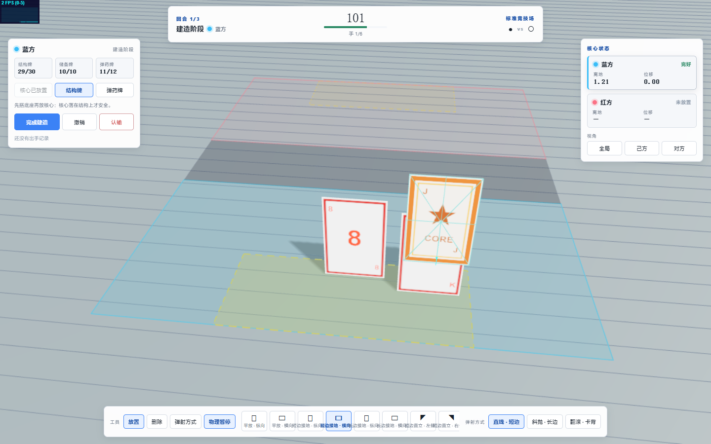

# 纸牌攻城 · 对战系统（Card Siege）

> 一句话：一人操作蓝红两方，**建造 → 稳定检查 → 回合（检查 / 工程 / 发射 / 结算）→ 核心被击落即负**。
> 物理即规则：没有血量、没有隐藏加成，胜负只由场上真实纸牌的位移决定。



## 一、为什么是这套规则

设计文档（[docs/pvp-battle-mode-design.md](pvp-battle-mode-design.md)）把对战拆成三件事：
工程设计、资源分配、弹射技术。本项目已有的弹射系统（接触点 + 蓄力 + 线速度/角速度）正好是第三件事，
所以这一版**没有新增任何"伤害数值"**，只补了三样东西：

1. **竞技场与区域**：双方各有建筑区，中间是中立缓冲区；
2. **核心牌与胜负判定**：核心牌落地 0.75 秒，或被推出合法区域 0.75 秒，即判负；
3. **回合控制器**：建造 → 稳定 → 每回合四个阶段，8 回合上限 + 平局判定。

## 二、场地

- 单侧建筑区：宽 14、深 7（以 Bridge 牌 1.8 × 2.8 为单位），中间 3.2 宽的中立缓冲区；
- 核心区：建筑区后部中央 7 × 3 的黄色区域，**核心牌必须放在这里且离地至少 0.9**；
- 双方核心默认相距约 14 个单位，最远弹道（24.5 速度、45°）射程约 61，足够互相打到；
- 场地标记由 `components/BattleArena.tsx` 画在地面上，规则本身在 `battle/arena.ts`。

## 三、回合流程

| 阶段 | 时长 | 能做什么 |
|---|---|---|
| 建造（蓝） | 150 s | 只能在自己的建筑区放结构牌 / 弹药牌，并放置核心牌 |
| 建造（红） | 150 s | 同上，换成红方 |
| 稳定检查 | 4 s | 双方都不能操作，**物理强制解除冻结**，结构自己站住才算数 |
| 检查 | 3 s | 无操作，看战场 |
| 工程 | 15 s | 放 1 张储备牌，或装填 1 张弹药；放完立刻进入发射 |
| 发射 | 20 s | 切到"弹射方式"工具，按住一张**自己的弹药牌**蓄力松手；也可以放弃 |
| 结算 | ≤ 6 s | 无操作；全场静止 0.4 秒后提前结束 |

每回合结束后换边，`回合 = 1..N`。回合用尽时依次比较：核心高度 → 核心位移 → 平局。
双方都没有核心 / 一方没有核心，直接在稳定检查结束时判负。

## 四、资源

默认每方 30 张结构牌 + 10 张储备牌 + 12 张弹药牌（核心牌不占预算），
在开始对战的设置面板里可以调整（结构 8–30、储备 0–10、弹药 2–12、回合 2–8、建造 60–240 秒）。

- **结构牌**：建造阶段放置，占结构预算；
- **弹药牌**：可以当结构用，也可以在发射阶段被弹射；占弹药预算，卡背是红色、牌面有红色三角；
- **储备牌**：只在工程阶段可用，每回合 1 张；
- **核心牌**：金色牌面 + ★，只能放一张，不能贴地。

## 五、判定细节

- **核心被击落**：核心牌最低点 ≤ 0.08，且相对放置时高度下降 ≥ 0.3，持续 0.75 秒；
- **核心出界**：核心中心离开己方核心区 0.75 秒（判负理由会写在结算面板里）；
- **危险状态**：离地 ≤ 0.55 或位移 ≥ 1.5，HUD 会变黄并提示；
- **冻结作弊**：建造阶段可以用"物理暂停"，但进入稳定检查时所有牌强制解除冻结；
- **删除 / 撤销**：建造阶段可以删牌、撤销；核心被删掉后需要重新放置。


## 六、代码结构

```text
battle/
  types.ts     数据模型：阶段、配置、双方状态、核心状态、射击记录
  arena.ts     场地几何与区域判定（isInsideZone / isCoreLegal / sideCamera）
  geometry.ts  四元数、卡片最低点、Euler→四元数（不依赖 three.js）
  engine.ts    纯状态机：tick / advancePhase / canPlace / recordShot / resign
hooks/
  useBattleController.ts   100 ms 心跳、核心采样、静止判定、发射记录、镜头请求
components/
  BattleSetup.tsx   开局设置（规则说明 + 回合/时间/预算）
  BattleHUD.tsx     阶段条、计时、双方核心、资源、行动面板、建造工具条、结算面板
  BattleArena.tsx   地面区域标记（蓝/红建筑区、黄色核心区、中立缓冲区）
scripts/
  battle-self-test.mjs     引擎自测（node，无需浏览器）
```

引擎是纯函数：`tick(state, dtMs, nowMs, options)` 返回新状态。
浏览器里的控制器只是每 100 ms 调一次 `tick`，把物理场景里的核心位姿采样传进去；
自测脚本则直接循环调用，所以规则可以在没有浏览器、没有 WebGL 的环境里验证。

## 七、怎么验证

```bash
npm run test:battle        # 引擎：建造顺序、回合循环、计时、核心判定、预算、工程限制、认输、回合上限
npm run test:battle:ui     # 可选：需要先 npm i -D playwright && npx playwright install chromium
                           # 并且有一个 npm run dev:web 在 127.0.0.1:5173
```

UI 自测会真的打开浏览器：进主菜单 → 打开对战设置 → 开局 → 用 `placementGuard` 的实时判词
扫描出一个合法核心位 → 放置结构牌 / 弹药牌 / 核心牌 → 完成建造 → 走完稳定检查和回合阶段，
并输出 `docs/screenshots/battle-*.png`。

## 八、这一版没做的（以及为什么）

- **人机 / 在线**：设计文档的路线是"本地 → 人机 → 好友在线 → 排位"。这一版只做本地：
  门控、客户端预测、服务器权威物理都不在仓库能力范围内（没有后端）。引擎已经按
  "输入 → 结算 → 快照"的方式拆开，接 AI 或服务器时可以复用；
- **四流派（炮台 / 飞镖 / 弩 / 投手）**：现在的弹射系统已经有三种出手方式
  （直线短边 / 斜抛长边 / 翻滚卡背），HUD 里的"弹射方式"就是流派雏形。真正的流派差异
  应该来自建筑形状，而不是数值，所以没有写成隐藏加成；
- **回放**：目前记录每次射击的关键数据（击倒张数、双方核心位移、出手速度），
  显示在"上一发"面板里；完整 3D 回放需要固定步长重放，属于下一步。
