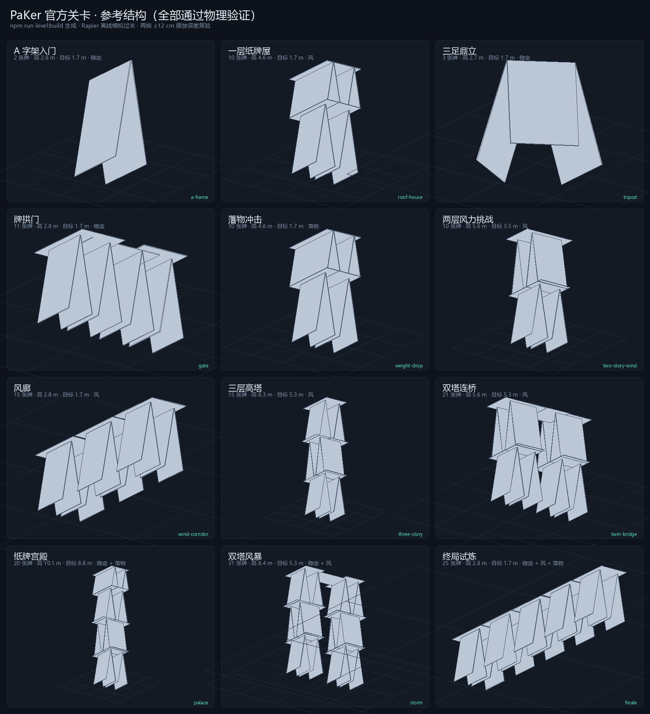

# 关卡工厂（Level Factory）

> 一句话：PaKer 的官方关卡不是手搭出来的，是**生成 + 物理验证**出来的。



## 一、为什么能这么做

一关的本质是数据：

```text
LevelDefinition = 蓝图快照（每张牌的四元数位姿）+ 测试阶段 + 教学提示 + 评分
```

蓝图快照里的 `position` / `quaternion` 是纯数值，`checksumBlueprint` 只是对
`JSON.stringify(blueprint)` 做 FNV-1a。也就是说：

- 关卡可以由程序写出来，不需要在编辑器里用手拖；
- 生成出来的关卡可以**离线跑一遍物理**，站不住就不发布；
- 关卡和蓝图永远同一份数据（`officialLevels.ts` 在导入时算 checksum），不会漂移。

## 二、流水线

```text
levels.mjs        关卡目录：牌数、目标高度、测试阶段、教学文案
structures.mjs    结构工厂：用积木拼出每题的标准答案
lib/blocks.mjs    积木：倾斜双牌（A 字架）、平放横梁、多层塔、拱门、风廊
lib/cards.mjs     几何：给定位姿的盒子、包围盒、任意两牌的最小间隙
lib/verify.mjs    验证：无头 Rapier，参数与游戏内完全一致
build.mjs         总装：生成 → 验证 → 写 services/officialLevelData.generated.ts
```

跑一次：

```bash
npm run level:build        # 生成 + 验证 + 导出
npm run test:level-factory # 用真实运行时服务复验生成结果
```

`build.mjs` 的验证门槛（任何一条不过，构建直接失败，不会写出不可玩的关卡）：

| 检查 | 阈值 |
|---|---|
| 任意两张牌的初始间隙 | ≥ 0.4 mm（不允许一开始就互相穿插） |
| 3 秒结算位移 | ≤ 5 cm |
| 关卡自带的测试阶段 | 必须通过（判定与游戏一致：结束时最高点 ≥ 0.72 × 目标高度） |
| 摆放误差 ±12 cm 复验 | 4 个方向全部通过 |
| 风力余量 | 至少 1.4 × 关卡风力 |
| 结构高度 | ≥ 关卡目标高度（否则玩家无法开始测试） |

## 三、积木只有两种牌姿

游戏里的放置预设只有 10° 倾斜，所以参考结构也只由这几种牌姿组成，玩家能凭预设复刻：

| 积木 | 说明 | 对应预设 |
|---|---|---|
| 短边支撑（tall pair） | 短边接地，两张相向倾斜，2.8 m 高 | `short_edge_forward/backward_10` |
| 长边支撑（low pair） | 长边接地，两张相向倾斜，1.8 m 高 | `long_edge_left/right_10` |
| 横梁（deck） | 平放的长牌，跨在两处脊线上 | `flat_landscape` |

组合出来就是：

- `storey` = 2 组短边支撑 + 1 张横梁（一层）；
- `tower` = N 层交错 90°（同向叠会整体倾覆，交错才抗风）；
- `corridor` = N 个单层并排（每跨独立承重，风从缝里过）；
- `gate` = 两个单层 + 一张门楣；
- `twinTowers` = 两座塔 + 一张连桥；
- `house` = N 层 + 一层长边支撑当屋顶；
- `tripod` = 3 张牌各向内倾 18°，顶端互压。

间距全部由求解得出，不是手填的常数：两个相向倾斜的盒子在顶端会相交，
工厂会对「沿倾斜轴向外推开量」做二分，直到间隙刚好 1.2 mm，顶端是真实接触而不是初始穿插。

## 四、加一关要改什么

1. `services/../scripts/level-factory/levels.mjs`：加一条关卡（结构 id、牌数、测试阶段、教学文案）；
2. `scripts/level-factory/structures.mjs`：在 `buildLevelStructure` 注册表里加结构工厂（可以复用积木）；
3. `npm run level:build`。

生成物会自动更新：

- `services/officialLevelData.generated.ts`（游戏读它）
- `public/levels/*.paker-level.json`（可导入的关卡文件）
- `public/official-campaign.json`（战役包）
- `docs/level-factory-report.md`（验证报告）

## 五、这套流水线修掉的两个真问题

### 1. 官方教学蓝图的屋顶是穿模的

旧的 `services/officialBlueprints.ts` 里，一层纸牌屋的两张屋顶牌在 X 方向重叠 1.36，
四根外围斜撑与 A 字架本体最深穿插 0.83。用无头 Rapier 跑一遍：3 秒内卡片飞到 32 米外。
现在的 12 关参考结构全部重新计算，任意两牌都有 ≥ 0.4 mm 的间隙。

### 2. 风力会随帧数无限累加

Rapier 的 `addForce` / `addForceAtPoint` 是**持续力**，要显式 `resetForces` /
`resetTorques` 才会清零。原实现每帧 `addForceAtPoint` 却从不清零，于是同一个
「风力强度 0.018」在第 1 秒末已经是 1.08 N，第 10 秒是 10.8 N——风本该是恒定的推力，
实际变成了加速器。现在 `components/Card.tsx` 在施力前清零（力与力矩都要清，
`resetForces` 不接管 `addForceAtPoint` 产生的力矩），风才是编辑器里那个数。

验证脚本 `lib/verify.mjs` 用同样的语义，所以关卡参数（本仓库里的 0.012 ~ 0.05）
是「恒定风力」，可以直接对着编辑器里的滑杆调。

## 六、预览

```bash
python scripts/level-factory/render_preview.py
```

读取 `public/levels/*.paker-level.json`，用等轴测投影把 12 个参考结构画成一张
`docs/screenshots/official-levels.png`。它不依赖浏览器和 WebGL，改完关卡可以立刻看一眼。
