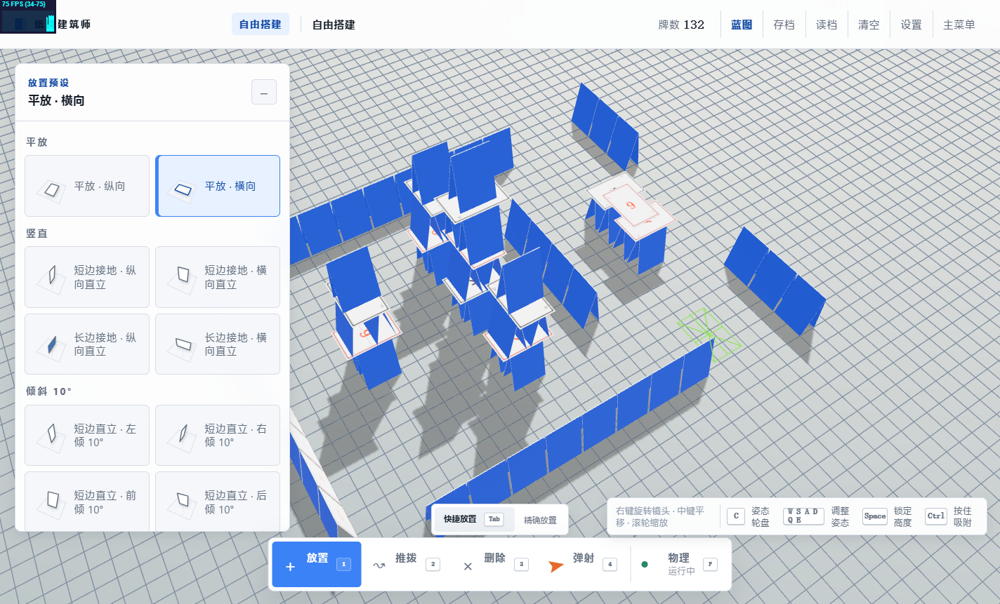

# 纸牌宫殿 · 存档



一座 132 张牌的纸牌宫殿，已经写进本机客户端「纸牌建筑师」的**存档库**里，名字叫 **纸牌宫殿**：

> 主菜单 → 自由搭建 → 读档 → 纸牌宫殿 → 读取

（存档走 localStorage，桌面客户端的存档在 `%APPDATA%\Electron` 下；浏览器版是另一个 profile，两边不互通。）

## 一、它长什么样

以中轴线排布的三进院落，四周是牌墙，正面开门：

| 单元 | 牌数 | 尺寸（长 × 深 × 高） | 说明 |
|---|---|---|---|
| 主殿 | 17 | 2.80 × 2.80 × 11.11 | 三层塔身 + A 字尖顶 |
| 左/右配殿 | 12 × 2 | 2.80 × 2.80 × 8.33 | 两层塔身 + 尖顶 |
| 后殿 | 12 | 2.80 × 2.80 × 8.33 | 两层塔身 + 尖顶 |
| 前廊 | 8 | 7.50 × 1.01 × 2.76 | 四组相向 A 字，廊柱 |
| 宫门 | 11 | 4.85 × 2.80 × 2.80 | 两根柱子 + 门楣 |
| 后/左/右墙 | 16 + 16 + 16 | — | 各 8 组 A 字，连成院墙 |
| 前墙两段 | 6 + 6 | — | 中间留出宫门 |
| **合计** | **132** | **19.85 × 25.39 × 11.11 m** | |

每个单元都是关卡工厂里**已被官方关卡验证过**的结构（`house` / `tower` / `portico` / `wall`），
单元之间留 1.0–2.2 m 的空隙、互不接触，所以整座宫殿靠每个单元自己站稳，没有任何隐藏支撑。

## 二、怎么做的（三条命令）

```bash
npm run palace:build     # 生成 saves/paper-palace.paker-save.json（走 validateGameSave 校验）
npm run palace:verify    # 无头浏览器：读档 → 让物理跑 7 秒 → 断言没塌
npm run palace:seed      # 启动真实 Electron 客户端，把存档写进真实存档库并验证能读出来
```

`palace:verify` 会真的走一遍玩家的路径：打开网页版 → 进自由搭建 → 读档 → 读取宫殿 →
让 Rapier 模拟 7 秒 → 再让游戏自己「保存」一次（保存时写的是**实时位姿**），
然后把两份卡牌位置逐张对比。判定标准写死在脚本里：倾角 < 8°、下沉 < 5 cm、位移 < 6 cm。

最近一次结果（`saves/paper-palace.verification.json`）：

```
max tilt 0.05°, max drop 0.022 m, max shift 0.023 m   →  PASS
```

也就是说 7 秒内所有牌几乎没动（毫米级沉降），宫殿是真的立住的，不是靠初始姿态骗过去。

`palace:seed` 会用 Playwright 启动 `electron electron/main.cjs`（和 `npm run dev` 同一个入口，
因此落在同一个 `%APPDATA%\Electron` profile 上），把存档合并进 `paker_build_save_library_v2`，
旧存档原样保留，并把写入前的库备份到 `_backup` 键——和游戏自己的保存逻辑一致。

## 三、代码

```text
scripts/palace/
  palace-structure.mjs   几何：单元组装 + 布局 + 牌间间隙检查（自己实现了正确的 SAT 间距）
  build-save.mjs         把几何变成 schema v2 存档，用游戏的 validateGameSave 校验
  verify-palace.mjs      无头浏览器物理验证 + 截图 + 生成 report
  seed-save.mjs          写进真实客户端存档库，并用真实 UI 读档验证
saves/
  paper-palace.paker-save.json        存档本体（可直接拷给别人）
  paper-palace.verification.json      最近一次物理验证结果
```

几个工程细节：

- **四元数 → 欧拉角**用 `THREE.Euler().setFromQuaternion(q, 'XYZ')`，和
  `instantiateBlueprintCards` 里的转换完全一致，保证读档后姿态和生成时一致；
- **牌间间隙**没有用关卡工厂的 `boxGap`（它返回「第一个」分离轴的间距，对远距离牌会少报），
  而是在 `palace-structure.mjs` 里实现了取最大分离轴的正统 SAT 版本；
- **尖顶**：`tower` 每一层都以平放的横梁收尾，所以塔身顶部是个平台；在上面再放一组相向 A 字
  （`pair`，2 张）就有了宫殿的坡顶轮廓。用三足鼎立放不上去——它底面积比横梁大，脚会悬空掉下去。

## 四、想改的话

```bash
# 换尺寸/间隙
node scripts/palace/palace-structure.mjs          # 只打印几何摘要（牌数、尺寸、间隙、穿模）
npm run palace:build && npm run palace:verify && npm run palace:seed
```

单元布局都在 `buildPalace()` 里：`gap`（院落间距）、`wingGap`（配殿贴主殿的距离）。
想加东西就照 `units` 数组往里塞一个 `{ name, cards, x, z }`，间隙检查会告诉你有没有撞上。
